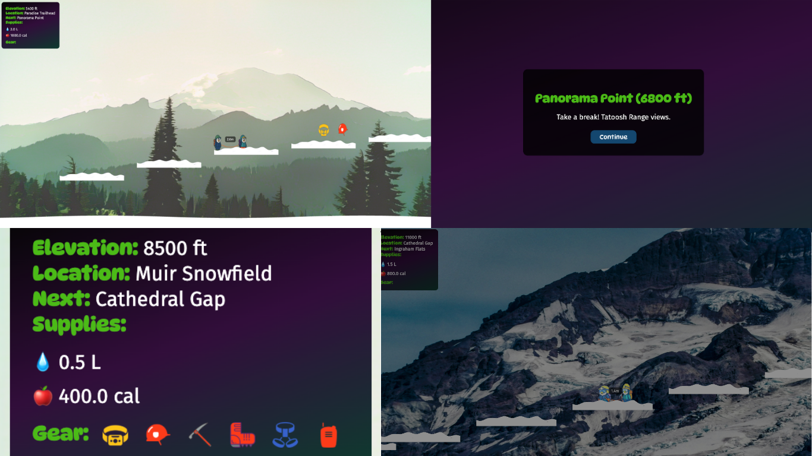

# Tether Traverse

*Navigate the slopes of Mount Rainier with your climbing partner!*
A cooperative platformer built for browser and mobile that simulates the iconic glacier ascent to the 14,410 ft summit of Mount Rainier. 

## How to Play
### Mobile 
- **Move:** Hold the ← / → buttons (left thumb)
- **Jump:** Tap the ↑ button (right thumb)
- **Pause / Sound:** Buttons in the top-right corner
- *Both climbers move together as a roped team. Best in landscape!*

### Desktop
- **Player 1:**  <mark style="background-color: #d3d3d3;">←</mark> / <mark style="background-color: #d3d3d3;">→</mark> arrows to move, <mark style="background-color: #d3d3d3;">↑</mark> to jump
- **Player 2:** <mark style="background-color: #d3d3d3;">A</mark> / <mark style="background-color: #d3d3d3;">D</mark> to move, <mark style="background-color: #d3d3d3;">W</mark> to jump
- **Pause:** <mark style="background-color: #d3d3d3;">Escape</mark> key, **Sound:** <mark style="background-color: #d3d3d3;">M</mark> key
- *Control both players simultaneously!*

### Goal
- Reach the summit of **14,410 ft**
- **Manage resources:** You begin with <mark style="background-color: #d3d3d3;">2 liters of water</mark> and <mark style="background-color: #d3d3d3;">1000 calories</mark>
- Collect tools like crampons, headlamp, and ice axe along the route
- **Rope spacing:** Keep climbers 1–3 m apart. Your spacing score is revealed at the summit
- **Don't fall:** Past the first few steps, a fall is game over

## Built With
- [Three.js](https://threejs.org/) - 2D/3D rendering
- JavaScript
- HTML5/CSS3
- Fully responsive: Playable in desktop and mobile browsers

## License
**Creative Commons Attribution-NonCommercial 4.0 International (CC BY-NC 4.0)**\
This means:
- **You can remix, adapt, and build upon this game**
- **Non-commercial use only**
- **Credit required** (please attribute to the creator)\
More info: [creativecommons.org/licenses/by-nc/4.0](https://creativecommons.org/licenses/by-nc/4.0/)

## Play Online
Play in your [browser](https://tether-traverse-9fc67c5fbd8e.herokuapp.com/) on desktop or mobile!